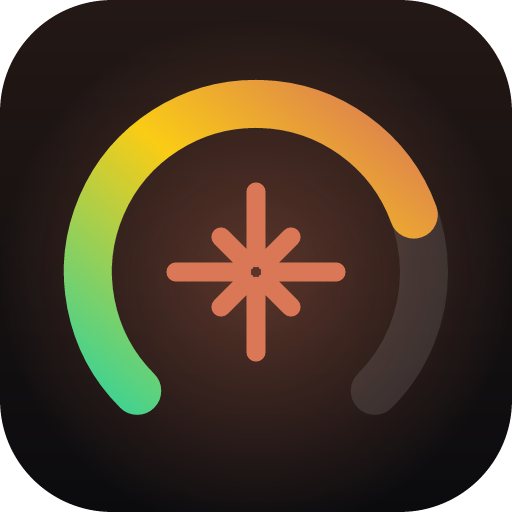
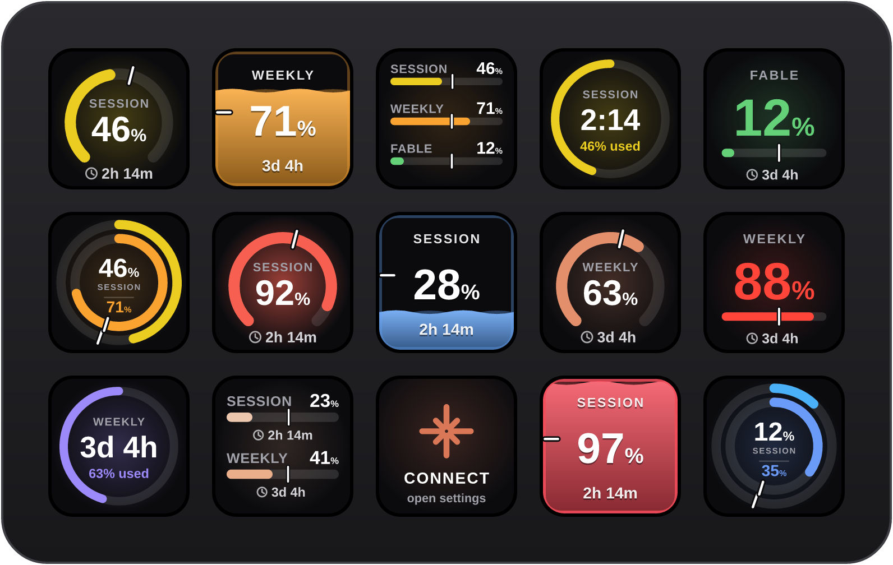
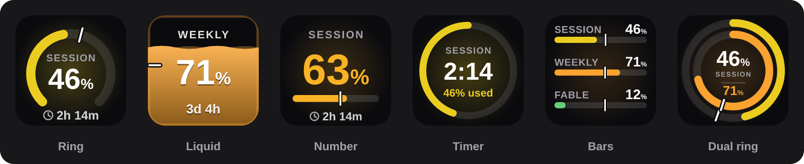
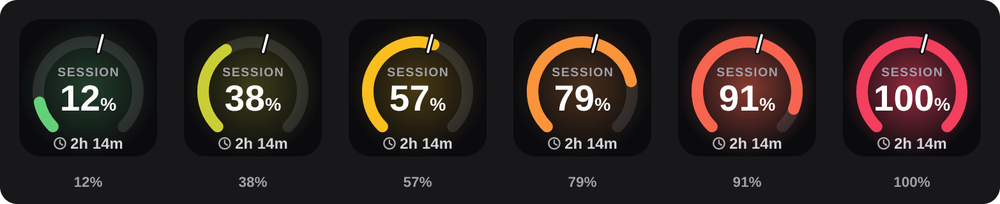
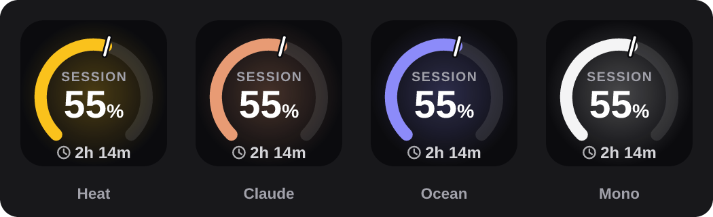
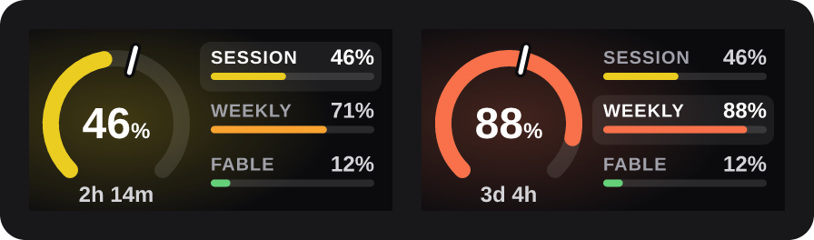
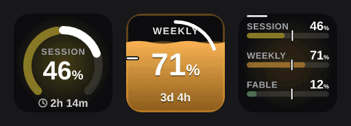
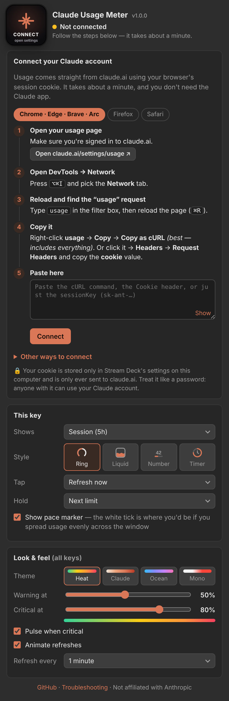
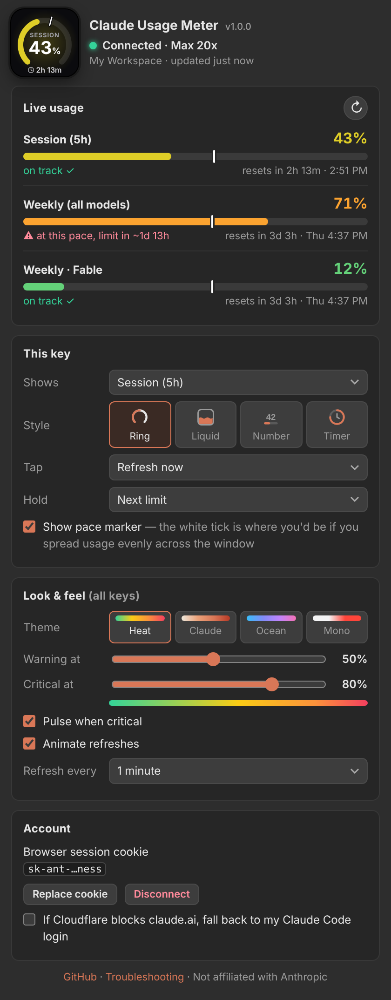

<div align="center">



# Claude Usage Meter for Stream Deck

**Your Claude & Claude Code usage limits, live on your Stream Deck.**<br/>
Session and weekly limits, per-model caps, reset countdowns and burn-rate pace. Colour-coded, animated and always up to date.

**No Claude desktop app required.**

[](https://github.com/ExecSam/streamdeck-cc/actions/workflows/build.yml)


[](LICENSE)



</div>

---

## Why?

If you live in Claude Code, the 5-hour session limit and the weekly cap are the two numbers that decide your day. Other Stream Deck plugins scrape them from the Claude desktop app, so they go blank the moment the app isn't running.

**Claude Usage Meter talks to claude.ai directly**, using the same session your browser already has. Paste one cookie, once, and your keys stay live whether or not anything else is open.

## Features

- ⏱️ **Every limit Claude reports**: the 5-hour session, the weekly all-models cap, and per-model weekly caps (Sonnet, Opus, Fable…) as they appear. New limit types show up automatically.
- 🎨 **Colour that means something**: keys warm from green → yellow → orange → red as you burn through a limit, with your own warning and critical thresholds. Four themes: *Heat*, *Claude*, *Ocean* and *Mono*.
- 🫀 **Alive, not static**: values sweep up when they refresh, a spinner shows a refresh is happening, and the glow *breathes* when a limit is critical.
- 🧭 **Pace marker**: a white tick shows where you'd be if you spread usage evenly across the window. Usage past the tick means you're burning hot. The settings panel goes further: *“at this pace, limit in ~1h 40m”*.
- ⌛ **Live reset countdowns** that tick on the key, and a dedicated **Timer** style.
- 👆 **Interactive**: tap to refresh, hold to flip between limits (both configurable). On Stream Deck + dials, rotate to switch limit and push to refresh.
- 🔄 **Auto-refresh** every 30 s – 10 min. It pauses when no key is visible, refreshes right after a window resets, backs off politely on errors, and re-syncs when your computer wakes.
- 🩺 **Helpful when things break**: an expired cookie, a Cloudflare block or going offline each get a clear key state and a one-click fix in the settings. Your last known numbers stay on screen with a small badge.
- 🔒 **Private**: your cookie lives only in Stream Deck's local settings and is only ever sent to claude.ai.

## Styles

Two actions, six looks. Mix and match them across your deck.



| Action | Styles | Best for |
| --- | --- | --- |
| **Usage Gauge** | Ring · Liquid · Number · Timer | One limit per key: session, weekly, a model cap, or *Auto* (whichever is closest to its limit) |
| **Usage Overview** | Bars · Dual ring | Everything on one key. Also runs on **Stream Deck +** dials |

### Colour that changes with your usage





### Stream Deck +

The Overview action fills the touch strip: a gauge for the focused limit, plus every other limit alongside it. **Rotate** to change focus, **push or tap** to refresh, **long-touch** to open claude.ai.



### Refreshing, animated



## Install

1. Download **`com.execsam.claude-usage.streamDeckPlugin`** from the [latest release](https://github.com/ExecSam/streamdeck-cc/releases/latest), or grab the build artifact from any [Actions run](https://github.com/ExecSam/streamdeck-cc/actions/workflows/build.yml).
2. Double-click it. Stream Deck installs it.
3. Find **Claude Usage Meter** in the actions list and drag **Usage Gauge** or **Usage Overview** onto a key.
4. Click the key and follow the setup guide in its settings (below). It takes about a minute.

> Requires Stream Deck 6.5 or newer on macOS 12+ or Windows 10+.

## Connect your Claude account

The settings panel walks you through this with tabs for Chrome/Edge/Brave/Arc, Firefox and Safari. In short:

1. Open **[claude.ai/settings/usage](https://claude.ai/settings/usage)** while signed in.
2. Open DevTools (<kbd>⌥⌘I</kbd> on Mac, <kbd>F12</kbd> on Windows) and go to the **Network** tab.
3. Type `usage` in the filter box and **reload the page**.
4. Right-click the **usage** request → **Copy** → **Copy as cURL**.<br/>
   *(Or click it → Headers → Request Headers and copy the `cookie` value.)*
5. Paste it into the plugin and hit **Connect**.

The plugin accepts whatever you throw at it: a cURL command (bash, Windows cmd or PowerShell), a “Copy as fetch (Node.js)” snippet, the raw Cookie header, or just the `sk-ant-…` session key. When the paste includes them, it also picks up your organization and your browser's User-Agent.

**Copy as cURL is recommended.** It carries your browser's Cloudflare clearance cookie and User-Agent, which makes requests look exactly like your browser's.

<table>
<tr>
<td width="50%"></td>
<td width="50%"></td>
</tr>
<tr>
<td align="center"><sub>Built-in setup guide</sub></td>
<td align="center"><sub>Live dashboard, per-key options and themes</sub></td>
</tr>
</table>

### Alternative: use your Claude Code login

Already signed in to Claude Code on this computer? Under **Other ways to connect**, choose **Use my Claude Code login**. The plugin then reads usage through Claude Code's OAuth token (`~/.claude/.credentials.json`, or the *Claude Code-credentials* keychain item on macOS, which asks you once for permission). You can also keep the cookie as your main source and turn on **fall back to my Claude Code login** for the times Cloudflare gets in the way.

The plugin only *reads* that token. It never refreshes or rewrites it, so it can't sign Claude Code out.

## Controls

| | Keys | Stream Deck + dial |
| --- | --- | --- |
| **Refresh now** | Tap *(configurable)* | Push, or tap the strip |
| **Next limit / style** | Hold *(configurable)* | Rotate |
| **Open claude.ai usage** | Configurable | Long-touch the strip |

Tap and hold can each be set to *Refresh*, *Next limit*, *Next style*, *Open claude.ai* or *Nothing*.

## Reading the keys

| You see | It means |
| --- | --- |
| **46%** | How much of that limit you've used |
| 🕑 **2h 14m** | Time until the window resets |
| White **tick** on the ring or bar | Where you'd be at an even pace. Ahead of it means you're burning fast |
| Glow **pulsing** | You're past your critical threshold (default 80%) |
| Small **amber badge** | Showing last known numbers. The latest refresh failed and will retry |
| Small **red badge** / **SIGN IN** | Your cookie has expired. Paste a fresh one |
| **ready** | That window hasn't started. It begins with your next message |

## Troubleshooting

<details>
<summary><b>The key says SIGN IN / “cookie expired”</b></summary>

claude.ai sessions eventually expire, or end when you sign out in the browser. Repeat the setup steps and paste a fresh cookie with **Replace cookie** in the settings. Your keys and preferences are kept.
</details>

<details>
<summary><b>The key says BLOCKED (Cloudflare)</b></summary>

claude.ai sits behind Cloudflare, which sometimes challenges requests that don't come from a browser. This is most common on VPNs and corporate networks. Try, in order:

1. Paste a fresh **Copy as cURL**. It includes `cf_clearance` and your browser's User-Agent.
2. Turn off your VPN or proxy.
3. Turn on **fall back to my Claude Code login** in the Account section.
</details>

<details>
<summary><b>OFFLINE, or the numbers are stale</b></summary>

The plugin couldn't reach claude.ai. It keeps showing your last known usage with a badge and retries with back-off: 1×, 2×, 4× your refresh interval, up to 15 minutes. Tap the key to retry immediately.
</details>

<details>
<summary><b>A limit I expected isn't listed</b></summary>

The plugin shows exactly the limits claude.ai reports for your plan. Model-specific caps only appear while they apply to you. If Anthropic adds a new kind of limit, it appears automatically under a best-guess name.
</details>

<details>
<summary><b>Is this allowed? Is it safe?</b></summary>

It reads the same usage endpoint the claude.ai settings page uses, as you, at a gentle rate (once a minute by default). Nothing is sent anywhere else. The endpoint isn't a public API, though, so it may change without notice. If it does, please [open an issue](https://github.com/ExecSam/streamdeck-cc/issues).
</details>

## How it works

```
claude.ai/api/organizations            →  find your organization (once)
claude.ai/api/organizations/{id}/usage →  five_hour, seven_day, per-model limits…
          │
          ▼
   UsageStore ── polls while keys are visible, backs off on errors,
          │      keeps the cookie jar fresh, refreshes right after resets
          ▼
   Presenter ─── one render loop for every key/dial: easing, spinner, pulse,
          │      countdowns. Redraws only when the image actually changes
          ▼
   SVG renderers ─ pure functions → crisp 144×144 keys and 200×100 strips
```

## Build from source

```bash
git clone https://github.com/ExecSam/streamdeck-cc.git
cd streamdeck-cc
npm install

npm run build      # bundle the plugin into com.execsam.claude-usage.sdPlugin/bin
npm test           # unit tests (parsers, store, renderers, animations)
npm run smoke      # end-to-end: launches the built plugin against a fake Stream Deck + fake claude.ai
npm run pack       # produce dist/com.execsam.claude-usage.streamDeckPlugin
```

For live development, install the [Stream Deck CLI](https://docs.elgato.com/streamdeck/cli/intro), then run `npm run link` once and `npm run watch`. The plugin rebuilds and restarts on every save.

Other handy scripts: `npm run previews` renders every key style to PNG, `npm run images` regenerates the README artwork, and `npm run icons` rebuilds the icons.

<details>
<summary>Project layout</summary>

```
src/
  plugin.ts              entry point, property-inspector bridge
  presenter.ts           render loop + animations for all keys/dials
  actions/               Usage Gauge + Usage Overview (keys, dials, press/hold)
  core/
    credentials.ts       cookie / cURL / fetch / PowerShell paste parser, cookie jar
    client.ts            claude.ai + Claude Code OAuth clients, error classification
    claude-code.ts       reads the local Claude Code login (opt-in)
    store.ts             polling, back-off, connect / disconnect
    usage.ts             payload normalisation, pace + projections
  render/                SVG key + touch-strip artwork, themes, formatting
com.execsam.claude-usage.sdPlugin/
  manifest.json, ui/ (settings panel), layouts/ (touch strip), imgs/
scripts/                 smoke test, settings-panel harness, image generators
test/                    vitest suites
```
</details>

## Credits

Inspired by [ClaudeUsageBar](https://github.com/Artzainnn/ClaudeUsageBar) and [CodexBar](https://github.com/steipete/CodexBar), whose work mapping out the usage endpoint made this easy. Built with the [Elgato Stream Deck SDK](https://docs.elgato.com/streamdeck/sdk/introduction/getting-started).

## Disclaimer

This is an unofficial community project, not affiliated with or endorsed by Anthropic or Elgato. “Claude” is a trademark of Anthropic. It relies on an undocumented claude.ai endpoint that may change at any time.

## License

[MIT](LICENSE) © ExecSam
